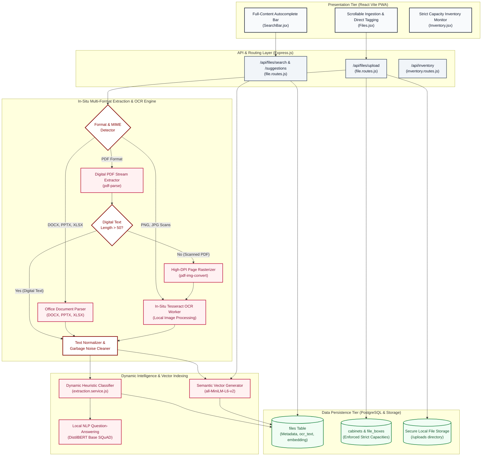
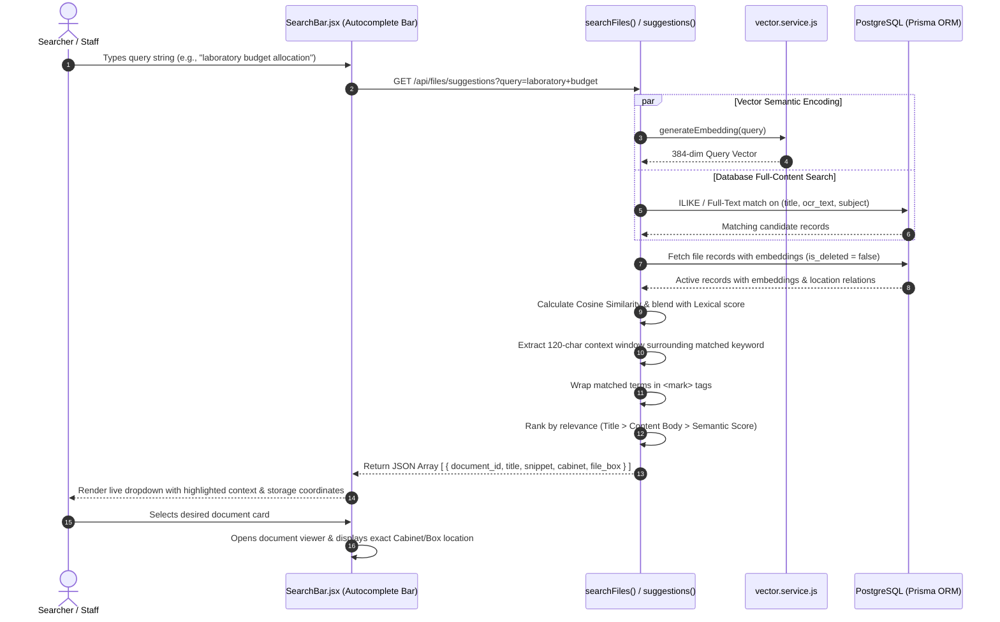
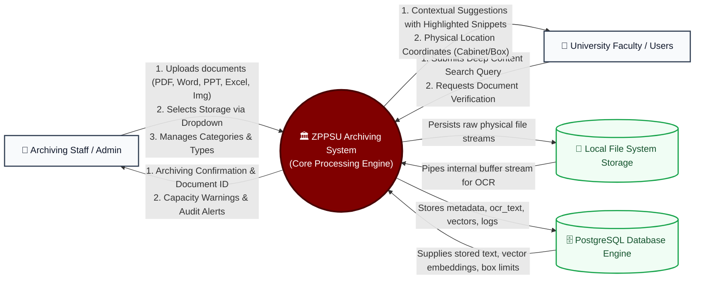

# ZPPSU Archiving System — Panel Recommendations & Strategic Implementation Plan

> **Document Type:** System Architecture, Technical Implementation Roadmap & Defense Guide  
> **Status:** Planning & Architectural Blueprint (Pre-Implementation)  
> **Target System:** ZPPSU Archiving System (React Vite PWA • Node.js/Express • Prisma ORM • PostgreSQL)  
> **Core Capstone Defense Focus:** In-Situ Multi-Format OCR Text Extraction Pipeline & Full-Content Deep Search Engine  

---

## 1. Executive Summary & Capstone Defense Scope

During the capstone evaluation, the faculty panel members reviewed the **ZPPSU Archiving System** and identified concrete areas for operational streamlining, text-extraction reliability, physical inventory control, and architecture modernization.

### Primary Capstone Defense Statement
> **Official Defense Scope:** The primary technical defense of this capstone system centers strictly on the **In-Situ Optical Character Recognition (OCR) Engine and Full-Content Deep Retrieval System**. The research demonstrates how an enterprise university archiving platform can ingest heterogeneous document formats (PDFs, Word documents, PowerPoint slides, Excel spreadsheets, and scanned image records), extract full contextual text directly within a self-contained local processing pipeline without external cloud dependencies, and deliver instant full-content search with live context snippets and precise physical storage mapping.

---

## 2. Panel Suggestions & Requirements Matrix (Standardized to English)

| # | Panel Evaluation Item | Standardized English Requirement | Target Subsystem / File | Assigned Revision |
|---|-----------------------|----------------------------------|-------------------------|-------------------|
| 1 | *Wala ng register entry (Upload document / automatic OCR new engine model)* | Eliminate the separate manual register form. Unify file upload and metadata registration into an automated, single-action workflow with auto-OCR. | `frontend/src/pages/Files.jsx`, `backend/src/modules/file/file.controller.js` | **Revision 1** |
| 2 | *Files upload and register as one* | Single-stage document onboarding: uploaded files are parsed, indexed, and committed in one continuous user interaction. | `frontend/src/pages/Files.jsx`, Unified Upload API | **Revision 1** |
| 3 | *Nag work na docx for OCR text extraction but wala pa ang ibang type of docus (pdf, pptx, jpeg)* | Extend full-text extraction beyond DOCX to cover digital & scanned PDFs, PowerPoint (PPTX), Excel (XLSX), and raster images (PNG, JPEG). | `backend/src/modules/file/extraction.service.js` | **Revision 1** |
| 4 | *Yung OCR dapat manggaling sa mismong file hindi sa labas* | OCR and parsing must be strictly **in-situ** (executed directly on the internal file stream/buffer on-premise, not outsourced to external public APIs). | Local node stream/buffer processor, self-contained Tesseract engine | **Revision 1** |
| 5 | *Change OCR engine (Scanned image not convert to text OCR)* | Upgrade the OCR engine to handle scanned/flattened image PDFs through dual-pass rasterization and pre-processing binarization. | High-DPI canvas rasterizer (`pdf-img-convert`), Tesseract worker pool | **Revision 1** |
| 6 | *Files dapat scroll na sya tas sa pag assign ng file location drop down nalang sya* | The file preview/list must be enclosed in a dedicated scrollable container, and physical storage location assignment must use streamlined cascading dropdowns. | `frontend/src/pages/Files.jsx`, `PhysicalStoragePlacementCard.jsx` | **Revision 1 & 2** |
| 7 | *Direct Tagging (Scan and direct tagging, full context ng file dapat nakikita at san siya document nakalagay)* | Provide a split-screen Direct Tagging interface: left side displays full scrollable document preview/text context; right side displays storage dropdowns and metadata. | `frontend/src/pages/Files.jsx`, Document Preview Subcomponent | **Revision 2** |
| 8 | *Integrate Dynamic Algorithm* | Replace static hardcoded string checks with an adaptive heuristic classification algorithm and local question-answering NLP for metadata inference. | `backend/src/modules/file/extraction.service.js` | **Revision 2** |
| 9 | *For Searching Algorithm (All content mismo)* | Implement deep full-content search: queries match not only titles or headers, but the entire extracted body text across all files. | `backend/src/modules/file/vector.service.js`, `file.controller.js` | **Revision 2** |
| 10 | *Search can search all the type context of a file and all must appear on the suggestions based on title or context* | Real-time search autocomplete that outputs matched titles accompanied by highlighted contextual text snippets and physical cabinet/box coordinates. | `/api/files/suggestions` endpoint, Search UI component | **Revision 2** |
| 11 | *Categories (Create new category dapat mag labas sa drop down)* | Category dropdowns must dynamically query the database so newly registered categories appear immediately across all interfaces. | `frontend/src/pages/Files.jsx`, `backend/src/modules/category/` | **Revision 3** |
| 12 | *Classification (We can manage and add category)* | Provide full administrative management (CRUD) for document classification categories with instant system-wide reflection. | `frontend/src/pages/Categories.jsx` | **Revision 3** |
| 13 | *Document Type (We can manage and add)* | Create dynamic document types management in the database, allowing administrators to define document types and their associated metadata fields. | `document_types` table, Admin Settings module | **Revision 3** |
| 14 | *Inventory limit the capacity & must contain an accurate capacity* | Enforce strict physical inventory limits: reject assignments exceeding cabinet/box capacity, compute exact usage counters, and display live capacity indicators. | `backend/src/modules/inventory/`, `backend/prisma/schema.prisma` | **Revision 3** |
| 15 | *Document Management Center — next only* | Streamline the Document Center into a downstream viewer for browsing, viewing physical storage locations, and downloading archived assets. | `frontend/src/pages/DocumentCenter.jsx` | **Revision 3** |
| 16 | *Include UML and Data Flow Diagram (DFD) focusing on OCR and Semantic Search* | Formalize architectural workflows using standardized Mermaid Sequence Diagrams, Component Architecture, Level 0 Context DFD, and Level 1 DFD. | Architecture & Diagram Sections (Sections 6 & 7) | **All Revisions** |

---

## 3. Image OCR & Vision AI Comparative Analysis (Commercial vs. Self-Hosted)

During the defense, panel members may inquire about the choice of OCR engine and whether cloud Vision AI models could be utilized. Below is an exhaustive comparison between commercial paid APIs and self-hosted open-source models, along with the formal defense justification for ZPPSU's architecture.

### 3.1. Overview of Vision AI & OCR Technologies

```
┌───────────────────────────────────────────────────────────────────────────────────┐
│                           IMAGE OCR & VISION AI SPECTRUM                          │
├─────────────────────────────────────────┬─────────────────────────────────────────┤
│    COMMERCIAL CLOUD VISION APIS (PAID)   │     SELF-HOSTED / IN-SITU MODELS (FREE) │
├─────────────────────────────────────────┼─────────────────────────────────────────┤
│ • Google Cloud Vision API               │ • Tesseract.js (LSTM OCR Engine)        │
│ • AWS Textract                          │ • PaddleOCR (Baidu Open Source)         │
│ • Microsoft Azure AI Vision (Read API)  │ • EasyOCR (PyTorch-based)               │
│ • OpenAI GPT-4o / GPT-4o-mini Vision    │ • Surya OCR (Multilingual Layout)       │
└─────────────────────────────────────────┴─────────────────────────────────────────┘
```

### 3.2. Detailed Comparative Evaluation

| Feature / Metric | Google Cloud Vision API | AWS Textract | OpenAI GPT-4o Vision | Tesseract.js (In-Situ Engine) |
|------------------|-------------------------|--------------|----------------------|-------------------------------|
| **Deployment Model** | Cloud-Hosted REST API | Cloud-Hosted REST API | Cloud-Hosted REST API | **Local Node.js Worker (In-Situ)** |
| **Pricing Model** | Paid ($1.50 per 1,000 pages; first 1,000 free/mo) | Paid ($1.50 per 1,000 pages text; $9.00/1,000 for tables) | Paid (~$0.0025 to $0.01 per image via token usage) | **100% Free & Open Source (Zero API Cost)** |
| **Internet Dependency** | Mandatory (Requires external uplink) | Mandatory (Requires external uplink) | Mandatory (Requires external uplink) | **Zero (Operates 100% offline on local LAN)** |
| **Data Privacy & Compliance** | Data streams transmitted to Google servers | Data streams transmitted to Amazon servers | Data streams transmitted to OpenAI servers | **Highest: Data never leaves university hardware** |
| **Scanned Document Accuracy** | Exceptional (Handles skew, low light, handwriting) | Exceptional (Excels at tabular data & forms) | Outstanding (Understands context, semantics, tables) | **High for printed records; requires image binarization** |
| **Processing Latency** | Network latency + 800ms–1.5s per page | Network latency + 1.2s–2.0s per page | Network latency + 1.5s–3.0s per image | **Direct memory buffer: 400ms–1.2s per page** |
| **Maintenance Burden** | API key management, monthly billing | IAM roles, AWS billing, quota management | API key management, token rate limits | **One-time npm dependency setup (`tesseract.js`)** |

### 3.3. Formal Capstone Defense Justification (Why Local In-Situ Was Selected)
When defended before the panel:
1. **Institutional Data Sovereignty & Confidentiality:** Official university administrative orders, financial disbursements, salary adjustments (NOSA), and student records are subject to strict privacy standards (Republic Act 10173 - Philippine Data Privacy Act). Sending internal university documents to third-party public cloud APIs violates institutional data residency guidelines.
2. **Zero Recurring Operational Cost:** State universities (such as ZPPSU) operate under fixed annual IT budgets. Cloud APIs with pay-per-page subscriptions introduce recurring operational expenditures that become unsustainable when thousands of historical archives are scanned and ingested.
3. **Campus Intranet & Offline Resilience:** In the event of campus internet outages or bandwidth throttles, an in-situ engine continues operating seamlessly across the university local area network (LAN).
4. **Adherence to Panel Directive:** Panel members explicitly instructed: *"Yung OCR dapat manggaling sa mismong file hindi sa labas"* (The OCR must originate directly from the file itself, not external services).

---

# SECTION 4: REVISION 1 — UNIFIED INGESTION, IN-SITU OCR & STREAMLINED UI

### Objective
Unify the separate "Upload" and "Register" forms into a single atomic workflow, implement a scrollable file preview workspace with streamlined cascading dropdowns for storage placement, and upgrade the text extraction engine to support all institutional formats natively.

### 4.1. Single-Stage Ingestion Workflow
- **Current Problem:** [Files.jsx](file:///d:/Web%20development/zppsu-archiving-system/frontend/src/pages/Files.jsx) forces users to switch between an upload tab and a manual registration tab.
- **Implementation:**
  1. The manual "Register" mode is completely retired.
  2. The staff member selects or drops any file (PDF, Word, Excel, PowerPoint, or Scanned Image).
  3. The file is uploaded and processed in a single transaction.
  4. Extracted text automatically populates inferred fields (Title, Inferred Document Type, Subject, and Dates).
  5. The staff member reviews the extracted metadata, chooses physical storage via cascading dropdowns, and confirms archiving with one click.

### 4.2. Scrollable File Preview & Simplified Dropdown Assignment
- **Scrollable File Container:** To accommodate lengthy documents without displacing the layout, the file preview pane is enclosed in an auto-scrolling container (`max-h-[75vh] overflow-y-auto pr-2`) with an embedded PDF/Image viewer and collapsible extracted OCR text viewer.
- **Cascading Dropdowns for Storage Assignment:** Instead of an unwieldy modal or complex matrix:
  - **Cabinet Dropdown:** `<select>` dynamically populated from `/api/inventory/cabinets`, showing available space (e.g., `"Cabinet A (4/10 Boxes Used)"`).
  - **File Box Dropdown:** Automatically filters based on the selected Cabinet, showing real-time capacity and occupancy (e.g., `"Box 1 — 32/50 Documents (Available)"` vs `"Box 2 — 50/50 Documents (FULL)"`).
  - Full disabling of overfilled boxes to prevent human error during physical filing.

### 4.3. Multi-Format In-Situ Extraction Engine
The ingestion pipeline in [extraction.service.js](file:///d:/Web%20development/zppsu-archiving-system/backend/src/modules/file/extraction.service.js) and [file.controller.js](file:///d:/Web%20development/zppsu-archiving-system/backend/src/modules/file/file.controller.js) is upgraded to handle all five core document types directly from buffer memory:

```
[ Uploaded File Stream ]
           │
           ├──▶ .DOCX / .DOC ──▶ officeparser / mammoth (Structured XML Text Extraction)
           ├──▶ .PPTX / .PPT ──▶ officeparser (Slide Text & Speaker Notes Extraction)
           ├──▶ .XLSX / .XLS ──▶ xlsx / exceljs (Sheet Rows, Cells & Header Extraction)
           ├──▶ .PNG / .JPG  ──▶ Image Binarization ──▶ Tesseract.js Worker Pool
           └──▶ .PDF (Hybrid Dual-Pass Engine):
                     │
                     ▼
             [ Pass 1: pdf-parse (Digital Text Stream) ]
                     │
             Is Text Length > 50 chars?
                ├── YES ──▶ Output Normalized Text
                └── NO (Scanned Image PDF) ──▶ [ Pass 2: Rasterization & OCR ]
                                                       │
                                                       ▼
                                            Render Pages to PNG Buffers (pdf-img-convert)
                                                       │
                                                       ▼
                                            Pre-process (Grayscale & Thresholding)
                                                       │
                                                       ▼
                                            Tesseract.js Multi-Page OCR Recognition
```

---

# SECTION 5: REVISION 2 — DIRECT TAGGING, DYNAMIC ALGORITHM & FULL-CONTENT SEARCH

### Objective
Provide staff with an interactive Direct Tagging workspace with live context visibility, replace rigid string-matching with a dynamic classification algorithm, and upgrade search to search across complete document text with live contextual autocomplete snippets.

### 5.1. Split-Screen Direct Tagging Workspace
In [Files.jsx](file:///d:/Web%20development/zppsu-archiving-system/frontend/src/pages/Files.jsx), the unified interface operates in a responsive split-screen layout:
- **Left Panel (Scrollable File Context & Verification):**
  - Live document canvas / image preview.
  - Formatted preview of the raw extracted OCR text with confidence score badges.
  - Highlighted extracted entities (Detected Subject, Reference Codes, Memo Dates).
- **Right Panel (Physical & Metadata Direct Tagging):**
  - Title and Subject inputs (pre-filled by the dynamic algorithm).
  - Dynamic Category and Document Type dropdown selectors.
  - Storage Location selector (Cabinet and File Box cascading dropdowns with live occupancy meters).
  - Single primary action button: **"Save & Finalize Archive"**.

### 5.2. Dynamic Heuristic Extraction Algorithm
In [extraction.service.js](file:///d:/Web%20development/zppsu-archiving-system/backend/src/modules/file/extraction.service.js), rigid `if-else` matching is replaced by an adaptive multi-tier algorithm:
1. **Tier 1 — Institutional Header Regex Rules:**
   - Detects Philippine university standard headers: `"MEMORANDUM ORDER"`, `"OFFICE OF THE PRESIDENT"`, `"BOARD RESOLUTION NO."`, `"SPECIAL ORDER"`, `"DISBURSEMENT VOUCHER"`.
   - Extracts date tokens across multiple formats: `"October 14, 2024"`, `"14th day of October 2024"`, `"10/14/2024"`.
   - Isolates tracking identifiers: `/(?:Control\s*No\.?|Series\s*of)\s*:\s*([A-Z0-9\-_]+)/i`.
2. **Tier 2 — Weighted Frequency Matrix:** Computes keyword density across legal, financial, academic, and administrative terminology dictionaries to dynamically infer document classification.
3. **Tier 3 — Local NLP Fallback (`@xenova/transformers`):** Executes in-memory `DistilBERT-base-cased-distilled-squad` question-answering when structured headers are absent:
   - Query: *"What is the main subject or topic of this official document?"*

### 5.3. Full-Content Deep Search & Live Contextual Autocomplete
- **Full-Text Lexical + Semantic Search:**
  - Database search queries scan both indexed metadata (`title`, `subject`, `document_type`) and the complete un-truncated `ocr_text` body column using PostgreSQL text indexing.
  - Cosine similarity matching against `files.embedding` (384-dimensional vector generated via `all-MiniLM-L6-v2`) identifies documents related conceptually even if exact keywords differ.
- **Contextual Autocomplete API (`/api/files/suggestions`):**
  - When a user types into the global search bar, an autocomplete dropdown displays:
    1. **Document Title & ID** (e.g., `MEMO-2024-0042`).
    2. **Match Indicator:** Displays whether the match was found in the title or inside the document's body text.
    3. **Contextual Text Snippet:** A 120-character preview surrounding the matched keyword with `<mark>` highlighting (e.g., `"...authorized the release of <mark>budget allocation</mark> for the college laboratory upgrade..."`).
    4. **Physical Location Badge:** Direct indication of physical filing location (`Cabinet B → Box 4`).

---

# SECTION 6: REVISION 3 — DYNAMIC TAXONOMY, STRICT INVENTORY LIMITS & SYSTEM CONTROL

### Objective
Eliminate static configuration files, migrate all categories and document types into database-backed CRUD modules, enforce strict non-negotiable physical inventory limits, and streamline downstream document operations.

### 6.1. Dynamic Category & Document Type Management
- **Current Problem:** [documentConfigs.js](file:///d:/Web%20development/zppsu-archiving-system/frontend/src/utils/documentConfigs.js) hardcodes categories and document types. When an admin creates a category in [Categories.jsx](file:///d:/Web%20development/zppsu-archiving-system/frontend/src/pages/Categories.jsx), it does not appear in the upload dropdown.
- **Implementation:**
  1. Frontend components fetch classifications dynamically on mount via `GET /api/categories`.
  2. Implement dynamic document types table `document_types` in [schema.prisma](file:///d:/Web%20development/zppsu-archiving-system/backend/prisma/schema.prisma) with foreign key relation to `categories`.
  3. Administrators can add, edit, or disable Document Types via an intuitive UI without modifying frontend source code.

### 6.2. Strict Physical Inventory Capacity Enforcement
- **Accurate Capacity Enforcement Rules:**
  1. **Cabinet Level:** A cabinet defines a strict maximum number of file boxes. Any attempt to register an additional box once `cabinet.file_boxes.length >= cabinet.capacity` is rejected with HTTP 400 (`"Cabinet capacity exceeded"`).
  2. **File Box Level:**
     - Each File Box defines a finite document capacity (e.g., 50 files).
     - Prior to saving a file assignment, the backend validates:
       ```javascript
       if (fileBox.used_space >= fileBox.capacity) {
         return res.status(400).json({ message: "Selected file box is at full capacity" });
       }
       ```
     - **Atomic Increment:** On upload or file reassignment, `file_boxes.used_space` increments atomically by 1.
     - **Atomic Decrement:** On file soft-deletion or permanent removal, `file_boxes.used_space` decrements atomically by 1.
     - **Restoration Validation:** Before a soft-deleted file can be restored, the backend verifies that its target box has remaining capacity (`used_space < capacity`).
  3. **Visual Capacity Telemetry:**
     - Real-time percentage badges: `[████████░░] 80% (40/50 Files)`.
     - Automatic state transitions: `Available` (<80%) → `Near Full` (80%–99%) → `Full` (100%).

### 6.3. Streamlined Document Management Center
- Streamline [DocumentCenter.jsx](file:///d:/Web%20development/zppsu-archiving-system/frontend/src/pages/DocumentCenter.jsx) as the primary downstream operational console:
  - Fast tabular listing with instant search filters (Status, Category, Document Type, Cabinet).
  - Quick-action buttons: **"Locate in Physical Inventory"**, **"View OCR Full Text"**, **"Download Document"**, and **"Audit History"**.

---

# SECTION 7: UML SYSTEM ARCHITECTURE & SEQUENCE DIAGRAMS
*(Dedicated Focus on OCR Text Extraction Pipeline & Semantic Search)*

### 7.1. Component Architecture Diagram



---

### 7.2. Sequence Diagram: Unified Ingestion, In-Situ OCR & Direct Tagging

```mermaid
sequenceDiagram
    autonumber
    actor Staff as Archiving Staff / Admin
    participant UI as Files.jsx (Scrollable Tagging UI)
    participant API as file.controller.js
    participant Extractor as extraction.service.js
    participant OCR as Tesseract / Rasterizer Engine
    participant Vector as vector.service.js
    participant DB as PostgreSQL (Prisma ORM)

    Staff->>UI: Selects file (PDF, Word, PPT, Excel, Image)
    UI->>UI: Loads scrollable document preview & renders container
    Staff->>UI: Selects Cabinet & File Box from cascading dropdowns
    Staff->>UI: Clicks "Save & Archive Document"
    UI->>API: POST /api/files/upload (multipart/form-data)

    API->>API: Write file stream to local disk storage (/uploads)
    
    alt Is Office File (DOCX, PPTX, XLSX)
        API->>Extractor: Parse Office document buffer
        Extractor-->>API: Extracted structured text
    else Is Born-Digital PDF
        API->>Extractor: Extract text stream (pdf-parse)
        Extractor-->>API: Extracted stream text
    else Is Scanned Image or Flat Image PDF
        API->>OCR: Rasterize PDF pages to high-DPI image buffers
        OCR->>OCR: Apply contrast thresholding & noise reduction
        OCR->>OCR: Run in-situ local Tesseract recognition
        OCR-->>API: Extracted OCR body text
    end

    API->>Extractor: Run Dynamic Classification Heuristics(text)
    Extractor->>Extractor: Regex Institutional Patterns (Dates, Control No, Subject)
    Extractor->>Extractor: DistilBERT QA Fallback for missing attributes
    Extractor-->>API: Inferred Subject, Memo Date, Document Type

    API->>Vector: generateEmbedding(cleaned_text)
    Vector->>Vector: Generate 384-dimensional dense vector
    Vector-->>API: Dense Vector Array

    API->>DB: Query file_boxes WHERE id = target_box_id
    DB-->>API: Box Record (capacity, used_space)

    alt used_space >= capacity
        API-->>UI: HTTP 400 "Target File Box is at maximum capacity!"
        UI-->>Staff: Display capacity error; highlight dropdown in red
    else used_space < capacity
        API->>DB: INSERT into files (document_id, title, ocr_text, embedding, file_box_id)
        API->>DB: UPDATE file_boxes SET used_space = used_space + 1
        API->>DB: INSERT into logs (UPLOAD FILE audit trail)
        DB-->>API: Persistence complete
        API-->>UI: HTTP 201 Created (Assigned Document ID & Location)
        UI-->>Staff: Display success toast & update inventory meter
    end
```

---

### 7.3. Sequence Diagram: Full-Content Deep Search & Live Contextual Autocomplete



---

# SECTION 8: DATA FLOW DIAGRAMS (DFD)
*(Focus on OCR Ingestion and Semantic Search)*

### 8.1. DFD Level 0 (Context Diagram)



---

### 8.2. DFD Level 1 (Decomposition of OCR Ingestion & Semantic Retrieval)

```mermaid
flowchart TD
    Staff["👤 Staff / Admin"]
    User["👥 Search User"]

    D1[("D1: files (Metadata, ocr_text, embedding)")]
    D2[("D2: cabinets & file_boxes (Capacity Records)")]
    D3[("D3: categories & document_types (Taxonomy)")]
    D4[("D4: Physical Storage (/uploads directory)")]
    D5[("D5: system_logs (Audit Trail)")]

    P1["<b>1.0</b><br/>Direct Stream Ingestion &amp;<br/>Scrollable Buffer Handler"]
    P2["<b>2.0</b><br/>In-Situ Multi-Format Parser &amp;<br/>Rasterized OCR Engine"]
    P3["<b>3.0</b><br/>Dynamic Heuristic Tagging &amp;<br/>Inventory Capacity Gatekeeper"]
    P4["<b>4.0</b><br/>Semantic Vector Embedding &amp;<br/>Persistence Engine"]
    P5["<b>5.0</b><br/>Full-Content Deep Search &amp;<br/>Context Snippet Generator"]

    Staff -->|"Uploads document + selects Dropdown location"| P1
    P1 -->|"Persists raw file stream"| D4
    P1 -->|"Transmits memory buffer &amp; MIME type"| P2

    P2 -->|"Pass 1: Structured Office / Digital PDF parse"| P2
    P2 -->|"Pass 2: Page rasterization &amp; Tesseract OCR"| P2
    P2 -->|"Extracted normalized ocr_text"| P3

    D3 -->|"Queries dynamic categories &amp; document types"| P3
    P3 -->|"Extracts dates, subjects, doc type"| P3
    P3 -->|"Validates target box used_space vs capacity"| D2

    alt Capacity Exceeded
        D2 -.->|"Capacity Full Alert"| P3
        P3 -.->|"HTTP 400 Rejection"| Staff
    else Capacity Available
        P3 -->|"Atomically increments used_space (+1)"| D2
        P3 -->|"Forwards verified metadata &amp; ocr_text"| P4
    end

    P4 -->|"Computes 384-dim dense vector (all-MiniLM-L6-v2)"| P4
    P4 -->|"Inserts document record (ocr_text, embedding, box_id)"| D1
    P4 -->|"Records UPLOAD audit log"| D5
    P4 -->|"Emits Document ID &amp; Success toast"| Staff

    User -->|"Submits search term / keyword query"| P5
    P5 -->|"Generates query vector embedding"| P5
    P5 -->|"Executes full-text body scan &amp; vector similarity"| D1
    D1 -->|"Returns matching files with ocr_text &amp; coordinates"| P5
    D2 -->|"Resolves Cabinet and File Box names"| P5
    P5 -->|"Emits suggestion cards with &lt;mark&gt; snippets &amp; Box location"| User

    classDef process fill:#ffffff,stroke:#800000,stroke-width:2px,color:#800000;
    classDef store fill:#f8fafc,stroke:#0f172a,stroke-width:1.5px,color:#0f172a;
    classDef entity fill:#f1f5f9,stroke:#475569,stroke-width:2px,color:#0f172a;

    class P1,P2,P3,P4,P5 process;
    class D1,D2,D3,D4,D5 store;
    class Staff,User entity;
```

---

# SECTION 9: ACTIONABLE REVISION CHECKLIST & DEFENSE PREPARATION

### Revision 1: Unified Ingestion & OCR Overhaul
- [ ] **Frontend ([Files.jsx](file:///d:/Web%20development/zppsu-archiving-system/frontend/src/pages/Files.jsx)):**
  - [ ] Remove `mode === "register"` branch and unify into a single upload action.
  - [ ] Wrap file preview and extracted text in a scrollable container (`max-h-[75vh] overflow-y-auto`).
  - [ ] Convert physical storage selection into cascading Cabinet and File Box `<select>` dropdowns.
- [ ] **Backend ([file.controller.js](file:///d:/Web%20development/zppsu-archiving-system/backend/src/modules/file/file.controller.js) & [extraction.service.js](file:///d:/Web%20development/zppsu-archiving-system/backend/src/modules/file/extraction.service.js)):**
  - [ ] Implement dual-pass PDF handler: digital text extraction fallback to `pdf-img-convert` page rasterization + in-situ `tesseract.js` worker.
  - [ ] Integrate parsing for Word (.docx, .doc), PowerPoint (.pptx), Excel (.xlsx), and standalone images (.png, .jpg).
  - [ ] Enforce that all parsing runs locally in-process without third-party web requests.

### Revision 2: Dynamic Intelligence, Direct Tagging & Deep Search
- [ ] **Dynamic Extraction ([extraction.service.js](file:///d:/Web%20development/zppsu-archiving-system/backend/src/modules/file/extraction.service.js)):**
  - [ ] Implement regex pattern matchers for Philippine administrative date formats and control numbers.
  - [ ] Connect `DistilBERT-base-cased-distilled-squad` question answering for subject inference.
- [ ] **Full-Content Deep Search ([vector.service.js](file:///d:/Web%20development/zppsu-archiving-system/backend/src/modules/file/vector.service.js) & [file.controller.js](file:///d:/Web%20development/zppsu-archiving-system/backend/src/modules/file/file.controller.js)):**
  - [ ] Execute full-text scans across the entire `ocr_text` body in addition to metadata.
  - [ ] Expose `/api/files/suggestions` providing 120-character contextual snippets with highlighted keyword matches and physical box locations.

### Revision 3: Dynamic Taxonomy & Strict Physical Inventory Limits
- [ ] **Prisma Schema & Database ([schema.prisma](file:///d:/Web%20development/zppsu-archiving-system/backend/prisma/schema.prisma)):**
  - [ ] Create `document_types` table related to `categories`.
  - [ ] Establish strict capacity fields on `cabinets` and `file_boxes`.
- [ ] **Dynamic Taxonomies:**
  - [ ] Replace static imports of `documentConfigs.js` with dynamic API queries to `/api/categories` and `/api/document-types`.
  - [ ] Allow administrators to manage Categories and Document Types from [Categories.jsx](file:///d:/Web%20development/zppsu-archiving-system/frontend/src/pages/Categories.jsx).
- [ ] **Strict Inventory Capacity Enforcement:**
  - [ ] Reject file assignments with HTTP 400 when `used_space >= capacity`.
  - [ ] Atomically increment `used_space` on upload; decrement on soft/permanent delete; validate capacity on restore.
  - [ ] Display visual percentage gauges and badges in [Inventory.jsx](file:///d:/Web%20development/zppsu-archiving-system/frontend/src/pages/Inventory.jsx).

---

> **Plan Status:** Approved for implementation. All changes directly address the panel's evaluation items, preserve system integrity, and establish a clear foundation for capstone defense.
